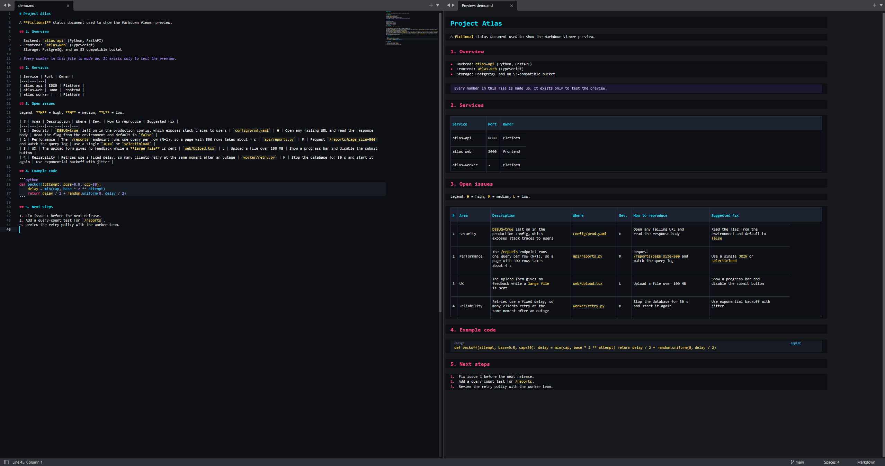
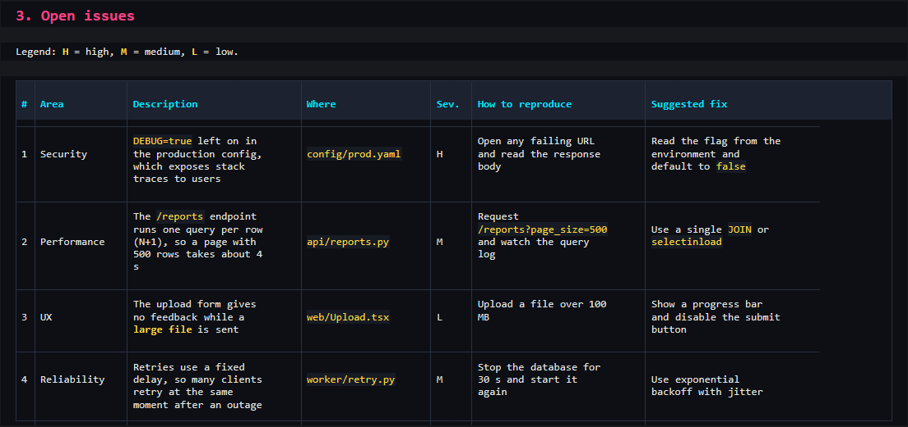

# Markdown Viewer V2

**English** | [Português (Brasil)](README.pt-BR.md)

A live Markdown preview for **Sublime Text 4**. It opens next to your editor, uses a dark neon theme, and keeps the two panes scrolled together.



## Features

- The preview opens on the right when you open a `.md` file, and updates as you type.
- Scroll sync in both directions, aligned by the `#` headings.
- Tables are drawn as real tables: aligned columns, borders, a highlighted header, and text that wraps inside each cell. The layout adapts to the window width and the font size.
- Code blocks have a **copy** link. The command *Markdown Viewer: Copy Preview Text* copies the whole preview as plain text.
- Bold, italic, `inline code`, links, lists, quotes and horizontal rules.
- Closing the file or the preview goes back to a single pane.



Try it with [`examples/demo.md`](examples/demo.md).

## Install

Sublime Text 4 is required. Clone the repository into your `Packages` folder. Keep the folder name `MarkdownViewerV2`.

```bash
cd "%APPDATA%\Sublime Text\Packages"
git clone https://github.com/GabrielGBcode/MarkdownPreview.git MarkdownViewerV2
```

If you still have the old `MarkdownViewer` (V1) package, remove it. Both use `Alt+M`.

## Use

| Action | How |
|---|---|
| Open or close the preview | `Alt+M` (also works inside the preview) |
| Copy a code block | Click **copy** on the block |
| Copy all preview text | Command Palette → *Markdown Viewer: Copy Preview Text* |

The keymap is for Windows. On macOS or Linux, add a key binding for the command `markdown_viewer_v2_toggle`.

## Settings

Edit `MarkdownViewerV2.sublime-settings`:

| Key | Default | Meaning |
|---|---|---|
| `auto_open` | `true` | Open the preview when you open a Markdown file |
| `delay_ms` | `300` | Wait (ms) after you stop typing before the preview updates |

## Limits

- You cannot select text in the preview with the mouse. This is a Sublime Text limit for HTML phantoms. Use the copy options above.
- Sublime Text HTML (minihtml) has no `<table>`. Tables are built from blocks with a fixed number of text lines per cell. A very narrow window can make long words break in the middle.
- The preview does not render images, HTML blocks or footnotes.

## Files

| File | Purpose |
|---|---|
| `markdown_viewer.py` | Plugin: preview tab, open and close, delayed update, scroll sync, copy. |
| `render.py` | Markdown to HTML blocks (minihtml) and plain text. Line-to-heading map for scroll sync. |
| `Neon.sublime-color-scheme` | Neon colors. Also usable as a color scheme for all of Sublime Text. |
| `vendor/markdown/` | Bundled Python-Markdown 3.7 (BSD-3-Clause, see its `LICENSE.md`). |
| `Default.sublime-commands`, `Default (Windows).sublime-keymap` | Command Palette entries and the `Alt+M` key. |
| `.python-version` | Selects Python 3.8 in the Sublime plugin host. |

## License

[MIT](LICENSE). The bundled Python-Markdown in `vendor/markdown/` uses the BSD-3-Clause license.
