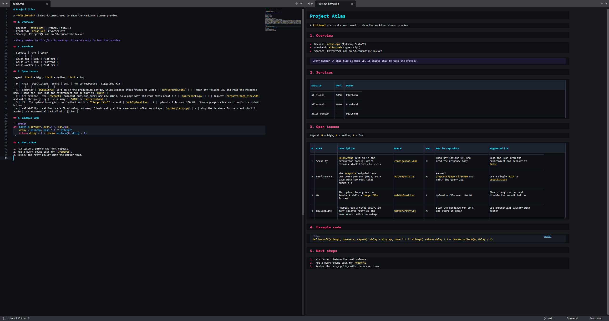
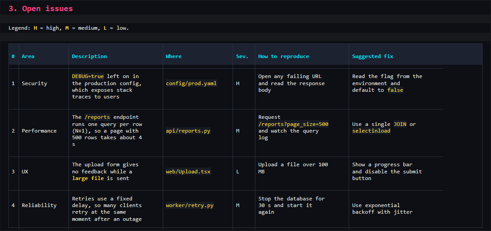

# Markdown Viewer V2

[English](README.md) | **Português (Brasil)**

Prévia de Markdown ao vivo para o **Sublime Text 4**. Ela abre ao lado do editor, usa um tema escuro neon e mantém os dois painéis com a rolagem sincronizada.



## Recursos

- A prévia abre à direita quando você abre um arquivo `.md` e atualiza enquanto você digita.
- Rolagem sincronizada nos dois sentidos, alinhada pelos títulos `#`.
- Tabelas desenhadas como tabelas de verdade: colunas alinhadas, bordas, cabeçalho em destaque e texto que quebra dentro da célula. O layout se adapta à largura da janela e ao tamanho da fonte.
- Blocos de código têm o link **copiar**. O comando *Markdown Viewer: Copy Preview Text* copia a prévia inteira como texto simples.
- Negrito, itálico, `código inline`, links, listas, citações e linhas horizontais.
- Fechar o arquivo ou a prévia volta para um painel só.



Teste com [`examples/demo.md`](examples/demo.md).

## Instalar

É preciso o Sublime Text 4. Clone o repositório na pasta `Packages`. Mantenha o nome de pasta `MarkdownViewerV2`.

```bash
cd "%APPDATA%\Sublime Text\Packages"
git clone https://github.com/GabrielGBcode/MarkdownPreview.git MarkdownViewerV2
```

Se você ainda tem o pacote antigo `MarkdownViewer` (V1), remova. Os dois usam `Alt+M`.

## Uso

| Ação | Como |
|---|---|
| Abrir ou fechar a prévia | `Alt+M` (também funciona dentro da prévia) |
| Copiar um bloco de código | Clique em **copiar** no bloco |
| Copiar todo o texto da prévia | Paleta de comandos → *Markdown Viewer: Copy Preview Text* |

O atalho vale para Windows. No macOS ou Linux, crie um atalho para o comando `markdown_viewer_v2_toggle`.

## Configurações

Edite `MarkdownViewerV2.sublime-settings`:

| Chave | Padrão | Significado |
|---|---|---|
| `auto_open` | `true` | Abre a prévia ao abrir um arquivo Markdown |
| `delay_ms` | `300` | Espera (ms) depois de parar de digitar antes de atualizar a prévia |

## Limites

- Não dá para selecionar texto da prévia com o mouse. É um limite do Sublime Text com HTML em phantoms. Use as opções de copiar acima.
- O HTML do Sublime Text (minihtml) não tem `<table>`. As tabelas são montadas com blocos que têm um número fixo de linhas de texto por célula. Uma janela muito estreita pode quebrar palavras longas no meio.
- A prévia não renderiza imagens, blocos HTML nem notas de rodapé.

## Arquivos

| Arquivo | Função |
|---|---|
| `markdown_viewer.py` | Plugin: aba da prévia, abrir e fechar, atualização com atraso, rolagem sincronizada, copiar. |
| `render.py` | Markdown para blocos HTML (minihtml) e texto simples. Mapa linha↔título para a rolagem. |
| `Neon.sublime-color-scheme` | Cores neon. Também serve como esquema de cores do Sublime Text inteiro. |
| `vendor/markdown/` | Python-Markdown 3.7 embutido (BSD-3-Clause, veja o `LICENSE.md` dele). |
| `Default.sublime-commands`, `Default (Windows).sublime-keymap` | Paleta de comandos e a tecla `Alt+M`. |
| `.python-version` | Seleciona o Python 3.8 no plugin host do Sublime. |

## Licença

[MIT](LICENSE). O Python-Markdown embutido em `vendor/markdown/` usa a licença BSD-3-Clause.
